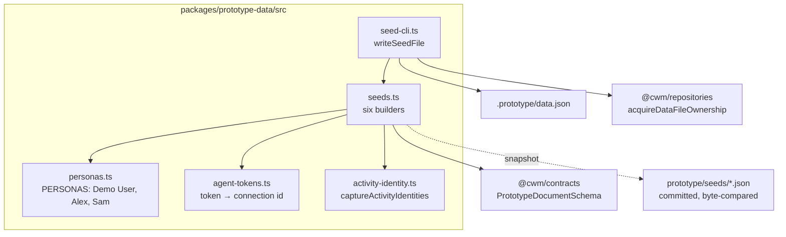

# What prototype data is made of

## Structure

## The seeds

| Seed | What it is for |
|---|---|
| `empty` | Every empty state; no agent connections, so no token authenticates |
| `personal-workspace` | The default after `pnpm prototype:reset`; a small realistic workspace |
| `busy-week` | Many tasks across dates: the dashboard, timeline and search |
| `nested-projects` | The integrated showcase since 25.8: a root with optional pages, three-level work units, Home shortcuts, archived ancestry, linked reflections, isolated agent connections |
| `overdue-chaos` | Overdue work; the simulated-date control's best demonstration |
| `agent-heavy` | Agent connections with the three fixture tokens; the MCP guides and contract harness seed |

## Inventory

| Part | Path | Role |
|---|---|---|
| `PERSONAS` | `src/personas.ts` | Three frozen `{ user, workspace }` pairs with stable ids and preferences |
| Agent tokens | `src/agent-tokens.ts` | `prototype-user-a-readwrite`, `-readonly`, `-revoked`; the host resolves them |
| `captureActivityIdentities` | `src/activity-identity.ts` | Capture and validate seed Activity target/project/root identity |
| Seed builders | `src/seeds.ts` | One function per seed over a fixed Monday-morning reference instant |
| `writeSeedFile` | `src/seed-cli.ts` | Atomic write of a seed over the repo-anchored data file; injectable path for tests |
| `seedDataFileOwned` | `src/seed-cli.ts` | The seed and reset CLIs' entry: `writeSeedFile` under the data file's owner record, refused while a host owns it |
| Snapshots | `prototype/seeds/*.json` | The builders' output, committed for plain-Node scripts and byte comparison |
