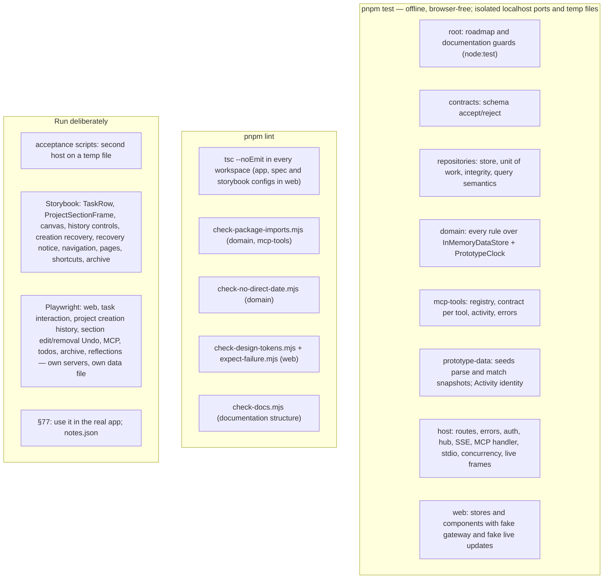
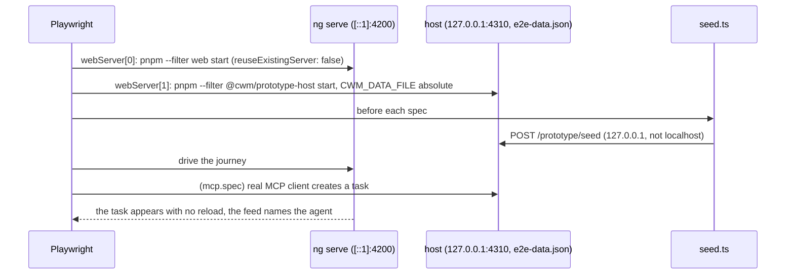

# What the testing system is made of

`apps/e2e/archived-projects.spec.ts` covers Settings recovery, persona isolation and the
disabled-Archive path beside `archive.spec.ts`'s ready-only root projection. Host acceptance
scripts check exact IDs over HTTP and both MCP transports; focused contract and domain tests
pin the structural eligibility and read result shapes.

Slice 69's untitled-source receipt label is checked in `mcp-acceptance.mjs` on both transports,
including the following history summary. Contracts pin `shortcutNameOf`'s title and owner
fallbacks; service tests pin every placement label, the add Activity summary, owner rename
capture and archived/hidden-source removal. Frame and canvas specs cover control names and
keyboard move announcements; browser journeys distinguish local and shortcut names, including
the seeded same-project Reflections source.

## The layers

`apps/e2e/task-interaction.spec.ts` covers Task List and Todos complete/reopen, exact owner
history, routed and injected refusals, keyboard focus, selection, drawer title edits and
read-only rows. `phone-layout.spec.ts` adds title-tap selection, Close focus return and reopen
at 375 px by touch in both themes. Transport reopen evidence lives in `api/routes.test.ts`
and `mcp-tools/src/contract.test.ts`, proved sensitive by a reverted timestamp-clear fault.

`apps/e2e/work-navigation.spec.ts` covers the root-name gear, explicit-parent Work plus,
stale parents, real create refusal, transport failure, archived-root blocking and two-tab
tree/Todos refresh. Creation-history journeys create through the Work plus and inspect the
navigation column; phone-layout also covers these controls at 375 px with touch.

## The e2e suite

## Inventory

| Part | Path | Role |
|---|---|---|
| Package suites | `packages/*/src/*.test.ts`, `apps/prototype-host/**/*.test.ts` | vitest, in-process |
| Root tooling suite | `scripts/roadmap.test.mjs`, `scripts/check-docs.test.mjs` | node:test, roadmap Outcome and built Compodoc anchor validation |
| Blur spike | `apps/e2e/ux/spike/blur-spike.mjs`, `variants.css` | Opt-in Slice 71 measurement, injected V0–V4, isolated static build and host, raw traces and paired captures outside every test command |
| Test support | `packages/domain/test/test-support.ts`, `packages/mcp-tools/test/harness.ts` | Store, clock, actor builders; persist counting; foreign-workspace injection |
| MCP transport fault child | `apps/prototype-host/mcp/test/fault-stdio.ts` | `startStdio` composition for one-shot persist failure and post-commit/pre-reply child exit; driven by the SDK stdio client in `stdio.test.ts` |
| Data-file ownership | `packages/repositories/src/data-file-ownership.test.ts`, `apps/prototype-host/data-file-ownership.test.ts`, `apps/prototype-host/test/owner-child.ts`, `packages/prototype-data/src/seed-cli.test.ts` | Slice 54: the owner-record primitive with injected liveness and filesystem errors, then real host, stdio, owner-child and CLI processes on temp files |
| MCP stdio clock child | `apps/prototype-host/mcp/test/clock-stdio.ts` | `startStdio` composition with one clock advanced from the exact receipt expiry; SDK client proves expiry, retained Archive, Activity and same-file restarts |
| Web specs and stories | `apps/web/src/**/*.spec.ts`, `*.stories.ts`; `apps/web/src/test-setup.ts` (empty storage before every test) | `ng test` (vitest under `@angular/build:unit-test`, non-isolated); Storybook |
| Fakes | `apps/web/src/app/core/gateway/testing/`, `core/live/testing/`, `prototype/control/testing/` | What every web spec injects |
| Import lint | `scripts/check-package-imports.mjs` | AST allowlist; `--allow`, `--label`, `--root` |
| Date lint | `packages/domain/scripts/check-no-direct-date.mjs` | §45; `time-lint.test.ts` proves it |
| Token lint | `apps/web/scripts/check-design-tokens.mjs`, `expect-failure.mjs` | §21; the self-test pins each fixture |
| Docs check | `scripts/check-docs.mjs`, `scripts/roadmap.mjs check` | The documentation protocol's rules |
| Acceptance | `apps/prototype-host/scripts/{acceptance,agent-acceptance,mcp-acceptance,live-acceptance}.mjs` | Slices 5, 13, 15, 16; `mcp-acceptance` also carries Slice 33's recovery, foreign-actor, grant-removal and revocation checks on both transports, Slice 37's `restore_section` and shortcut-tool envelopes and chains, Slice 38's `set_project_page_enabled` journey — receipt and `null` envelopes, exact ids, `projects.write` alone, another connection's not-found and a revoked connection's page receipt — Slice 39's project-update block on both transports, and Slice 45's task add → complete → rename → Delete chain with exact fields and cascade markers, reflection add/archive/restore, layout and progress Undo/Redo, and (Streamable HTTP, whose host has a simulated clock) Archive Restore after a removal's history expired; Slice 53's SDK `stdio.test.ts` adds the same expiry and durable recovery evidence for stdio; Slice 65 adds a Work-canvas shortcut on a created workstream to both scripts and, in `mcp-acceptance`, a forward cross-root move refused for splitting a placement; Slice 67 adds exact Markdown source read-back from SDK and disk after update/Undo and descendant task reopen with owner history and exact timestamp Undo/Redo on both transports; Slice 68 removes a split placement by the id parsed from the described refusal and proves the same description on a refused Undo of the move, on both transports; Slice 69 checks the untitled-source receipt label and following history summary |
| Recovery acceptance (host) | `apps/prototype-host/recovery-undo-acceptance.test.ts`, `live-updates.test.ts`, `page-history-acceptance.test.ts` | Seeded nested-projects files prove actor-owned cursor, revision and action persistence across restart, and durable Archive after history expiry and pruning; Slice 66 removed the conversion cases and legacy fixtures; `live-updates.test.ts` adds commit-before-publish and the compound row Add fault matrix; `page-history-acceptance.test.ts` adds the optional-page commit boundary — recorder, action-update, cursor-update and persist failures in both directions, each asserting unchanged file bytes, history and zero frames — plus the applied/undone reopen at the current version. Slice 45 adds canonical Restore races — task, subtask, reflection, section and project Restore under an archived owner, parent or ancestor over HTTP and the MCP registry — a removal Redo refused by a new row, and recorder/persist faults through the MCP tool path, each with unchanged memory, disk bytes and zero frames. Part of `pnpm test` |
| Row history chains | `packages/domain/src/row-history.test.ts`, `packages/prototype-data/src/activity-identity.test.ts` | Task and reflection Undo/Redo chains, grants, compound containers and later-dependent refusals — since Slice 45 also task Delete over live and independently archived descendants, Undo of a task Restore, Undo Add absent from Archive, the task no-op and the reflection transition grant; since Slice 48 task edit, completion, reopen, move and reparent refusals under an archived current or target section, each with its exact conflict list and its recovery after a Restore; Slice 49 adds archived completion and reopen history, section/parent cascade deduplication, combined repair and field-order evidence; seed Activity identity capture |
| Slice 49 repair checks | `packages/domain/src/task-service.test.ts`, `operation-execution.test.ts`, `operation-history-service.test.ts`, `packages/mcp-tools/src/contract.test.ts` | Archived destination reparent refusal and `tasks.write` preservation; all eight conflict `nextStep` wordings, retirement and five-item cap; `history_conflict:` versus `history_retired:` guidance; MCP registry archived section/task refusal and recovery |
| E2E | `apps/e2e/playwright.config.ts`, `prepare-data.ts`, `seed.ts`, `web.spec.ts`, `task-interaction.spec.ts`, `canvas-editing.spec.ts`, `section-edit-undo.spec.ts`, `removal-undo.spec.ts`, `row-history.spec.ts`, `canvas-history.spec.ts`, `page-history.spec.ts`, `project-history.spec.ts`, `project-creation-history.spec.ts`, `history-controls.ts`, `mcp.spec.ts`, `todos.spec.ts`, `archive.spec.ts`, `archived-projects.spec.ts`, `reflections.spec.ts`, `phone-layout.spec.ts` | §69's journeys; `pree2e` refreshes the scratch document; Slice 36 adds browser commit boundaries, shared row history, live projections and compound implicit-container Undo/Redo, Slice 37 adds placement, Restore and duplication history with two-tab reconciliation, Slice 38 adds the optional-page toggle, its Open archive boundary, route fallback and blocked creation inverse, Slice 39 adds header project history and cross-root reparent refresh on Todos and Archive, Slice 41 adds header Undo/Redo, Slice 42 adds creation Undo, same-id Redo, same-URL recovery and cross-owner not-found, Slice 43 adds one-step removal and task Delete on both task surfaces, Slice 44 adds workspace Settings recovery, parent-first Archive and narrow touch checks, and Slice 45's `project-history.spec.ts` closure journeys add header controls with Archive disabled, populated off Home, contained and tapped at 375 px in both themes beside another persona, the exact-field task chain on a moving Clock, and layout, progress and shortcut-move history with Archive recovery after expiry, and Slice 47 adds the stale root-Archive pause through a held quiet frame and keyboard Retry, and Settings recovery focus (remaining row, revealed child, Retry, moved focus) by keyboard and tap in both themes; Slice 57 adds committed Task List and Todos Delete recovery cues and owner/Archive routes; Slice 58 adds the phone navigation drawer, column re-collapse, stacked details drawer, overflow and resize evidence; Slice 65 adds a shortcut on Kitchen's Work canvas in `canvas-editing.spec.ts` — insertion, keyboard resize and reorder, collapse, header Undo/Redo in Kitchen's history, Open source and removal; Slice 67 adds the literal six-type picker and both-theme Markdown touch editing at 375 px plus span-4 Grid code scrolling and containment |
| Milestone walkthrough | `docs/guides/first-milestone-walkthrough.md` | The manual click-path for every §81 bullet |

## Visual audit evidence

apps/e2e/ux-capture.config.ts reuses the e2e servers on isolated ports. ux/matrix.ts names selected cells, ux/capture.ts collects screenshots/axe/ARIA/console/layout evidence, ux/evidence.mjs preserves partial failures, and ux/tasks.ts records scripted task costs. The axe Playwright adapter is a development-only dependency of the e2e package. ux/walk/ is the disposable interactive audit rig used for Phase 1: per-auditor isolated hosts, a persistent headless page driven over HTTP, and the orchestrator's reproduction scripts.
`ux/layout.mjs` collects keyed plane-container boxes; its node:test fixture proves repeated frames retain distinct indices.

Slice 71 adds `ux/depth-verification.ts` for live fallback/focus/Lab/device evidence and `docs/roadmap/70-ui-ux/tooling/build-sheet.mjs` for paired captures, strict box comparisons and contrast reporting. Eight Node regressions in `build-sheet.test.mjs` protect evidence completeness and the narrow Lab exceptions, including the single uniform shift of the original Lab knobs. The verification run asserts `data-theme` and the focus-ring colour at every capture, because CDP media resets can otherwise repaint a labelled theme.
