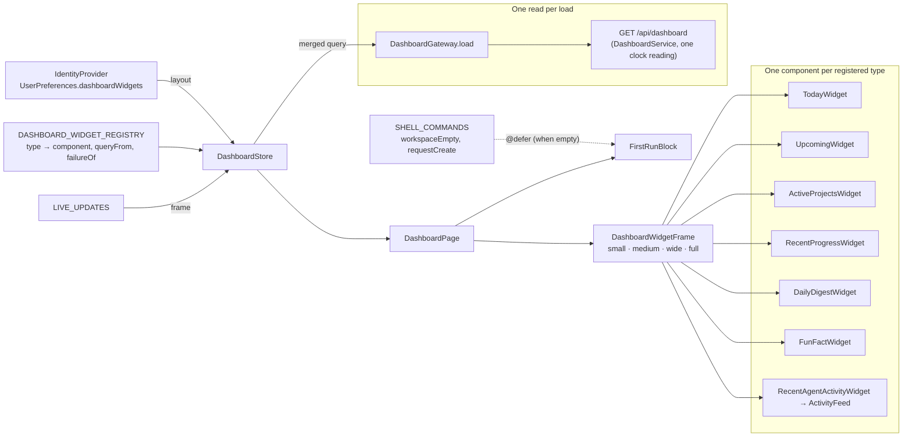

# What the dashboard is made of

## Structure

## Inventory

| Part | Path | Role |
|---|---|---|
| `DashboardPage` | `dashboard-page.ts` | Renders each visible widget in its size; honest note for an unregistered type |
| `FirstRunBlock` | `first-run-block.ts` | Home's first run (Slice 79): the sentence and New project (`data-first-run-create`, calling `requestCreate()`); behind `@defer (when shell?.workspaceEmpty())` above the widgets, and hides itself once the workspace stops being empty |
| `DashboardStore` | `dashboard-store.ts` | Joins layout and content; re-reads on frames; its read failure is a `Failure`; `retryDigest` re-reads quietly with `digestPending` |
| `DASHBOARD_WIDGET_REGISTRY`, `DashboardWidgetDefinition`, `DashboardWidgetComponent`, `DashboardWidgetInputs` | `widgets/registry.ts`, `widgets/widget-contract.ts` | The list and the contract every widget implements; each definition's `icon` is an `IconName` from the shared SVG set, rendered by the widget frame; an optional `failureOf` (the digest's `dailyDigestFailure`) makes the frame render a `FailureMessage` with Try again instead of the widget |
| `DashboardWidgetFrame` | `widgets/widget-frame/` | The common chrome and size classes; renders a definition's failure in the widget's place, with `pending` and a `retry` output |
| `taskOriginRoute`, `taskOriginFragment` | `widgets/task-origin-link.ts` | A task's owner link (Slice 79): the route (`/projects/:id` for a work unit, `/projects/:id/pages/:kind` otherwise) and `section-:id`; used by Today and the digest's overdue list |
| Seven widgets | `widgets/{today,upcoming,active-projects,recent-progress,daily-digest,fun-fact,recent-agent-activity}/` | One folder each; shared `widget-content.scss`, and the digest's own `daily-digest-widget.scss` for its overdue list |

The common widget frame also owns the sheet-plane paint; every widget inherits the same token treatment.

Task widgets compose RouterLink, the global object-row slots and tasks/task-meta.ts. Their gateway/store read path is unchanged. Active Projects adds an ancestor context line to the same row anatomy.
