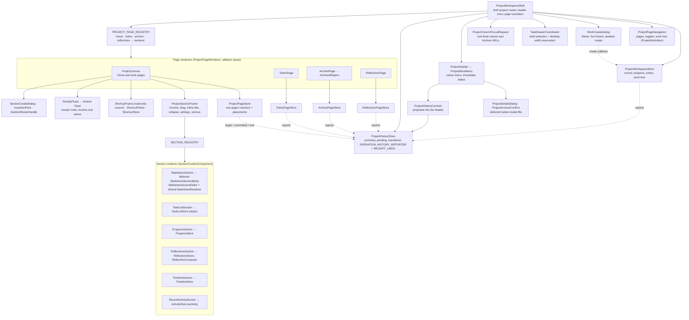
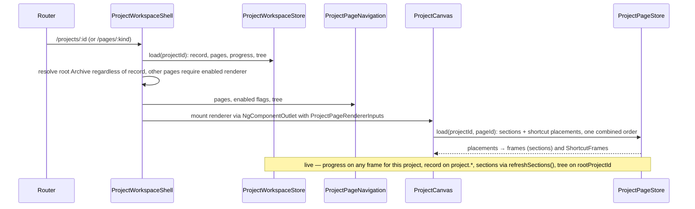

# What the projects feature is made of

## Structure

## Opening a root's Home

## Inventory

| Part | Path | Role |
|---|---|---|
| `ProjectWorkspaceShell` | `project-workspace-shell.ts` | Both routes; header and `#history-controls` focus after render; page resolution and fallback notice; breadcrumbs for a subproject; creator recovery at a missing project's URL, with a generic Retry when the summary read is unavailable for any reason but `not_found` |
| `ProjectWorkspaceStore`, `WorkTreeNode` | `project-workspace-store.ts` | Project-level state and writes; authoritative `missing` state after a not-found read |
| `ProjectPageNavigation`, `ProjectWorkItem` | `project-page-navigation.ts`, `project-work-item.ts` | The column and its rows; `linkSelected` reports a plain link activation from a capture-phase listener |
| `ProjectColumnFocusRequest` | `project-workspace-shell.ts` | Root-scoped: narrow column and explicit Archive URL requests until their rendered targets can take focus |
| `ProjectHeader`, `ProjectMoreMenu` | `project-header.ts`, `project-more-menu.ts` | Name, status, progress, target date; a projection slot for the history controls; rename/status/date/archive (Archive not offered on an archived project). More is an auto-popover menu with immediate status radios, Edit details, Open archive set apart from the status radios by a separator, and a separated danger Archive item; deferred details and confirm dialogs return focus to More |
| `ProjectDetailsDialog`, `ProjectArchiveConfirm` | `project-details-dialog.ts`, `project-archive-confirm.ts` | Native modal lifts: one draft Save and dirty-dismissal handling; separate archive confirmation |
| `ProjectHistoryStore` | `history/project-history-store.ts` | The displayed project's summary, public generation/write sequence, coalesced owed reads and one transition guard; implements `OperationHistoryReporter` and `ReceiptUndo` without adopting cross-owner summaries |
| `ProjectHistoryControls` | `history/project-history-controls.ts` | Two `aria-disabled` icon buttons named by their step or reason; Retry when unreadable; results go to the shell's toast |
| `ProjectCreationRecovery` | `project-creation-recovery.stories.ts` | Storybook coverage for available Redo, pending and archived-parent blocked recovery states |
| `historyControl`, `transitionResultFeedback`, `transitionRefusalFeedback`, `crossOwnerFeedback`, `archivedHereFeedback`, `nextStepCopy` | `history/history-feedback.ts` | Pure confirmation and transition copy, exhaustive over the contract unions |
| `PROJECT_PAGE_REGISTRY`, `ProjectPageDefinition` | `project-page-registry.ts` | Navigable kinds → renderer, label and `IconName` mark |
| `ProjectPageRenderer`, `ProjectPageRendererInputs` | `project-page-contract.ts` | What every renderer receives |
| `ProjectCanvas` | `project-canvas.ts` | One page's canvas: contextual insertion, drag-drop, snapped resize, explicit edit receipts, one-gesture cascade removal and arrival at `#section-<id>` |
| `ProjectPageStore`, `CanvasWriteResult`, `SectionRecoveryNoticeState` | `project-page-store.ts` | Sections and placements of one page; positioned creation, ID-only removal/retry, write reporting and recovery-notice state |
| `ReceiptToast`, `Toast` | `core/history/receipt-toast.ts`, `shared/feedback/toast.ts` | One docked confirmation with receipt Undo, Open archive when listed, explicit removal retry or read-only refresh retry |
| `SectionCreateDialog` | `section-create-dialog.ts` | Section or shortcut creation at the selected canvas position |
| `InsertionPoint`, `SectionResizeHandle`, `gridInsertionGaps`, `moveDirectionFor` | `canvas-chrome/` | Insertion overlays, snapped resize, sparse-grid gap targets and grip move keys |
| `TodosPage`, `TodosPageStore` | `pages/todos-page*.ts` | §34's chronology with task complete/reopen checkboxes, one-way workstream Complete, serialized writes and Delete, canonical content links, descendant owner-history links and committed Delete/Complete toasts |
| `ArchivePage`, `ArchivePageStore`, `ArchivedRegion` | `pages/archive-page*.ts`, `archived-region/` | §31's ready-only root projection, owner-first recovery copy, Restore toasts and descendant owner-history links |
| `ReflectionsPage`, `ReflectionsPageStore` | `pages/reflections-page*.ts` | §36's page, the completed-work picker, the journal; the explicit Add container and reflection writes report to the header's history |
| `SECTION_REGISTRY`, `SectionDefinition` | `sections/registry.ts` | §29; each type's `icon` is an `IconName`, never shared with a page kind except Reflections |
| `SectionContentComponent`, `SectionContentInputs` | `sections/section-contract.ts` | What every content component receives |
| `ProjectSectionFrame` | `sections/section-frame/` | §31's always-available drag, collapse, inline title, optional inspector and remove controls |
| Six section types | `sections/{markdown,tasks,progress,reflections,timeline,activity}/` | Content components and their stores |
| `ShortcutFrame`, `ShortcutPicker`, `ShortcutStore` | `shortcuts/` | §27's shortcuts, on Home or a workstream's Work canvas |

The column, header, section and shortcut frames consume shared plane tokens; their ownership and component composition stay unchanged.
