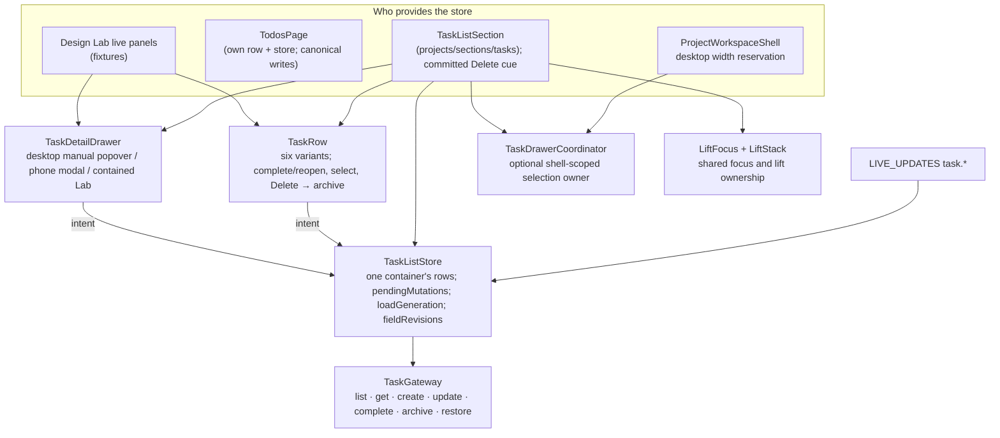
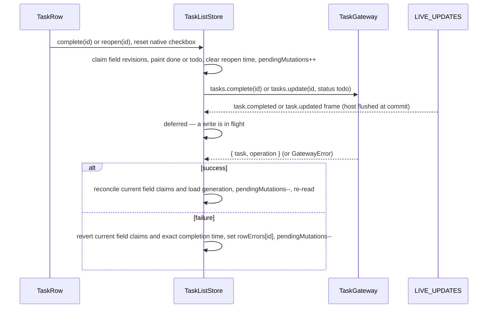

# What the tasks feature is made of

## Structure

## Optimistic completion toggles

## Inventory

| Part | Path | Role |
|---|---|---|
| `TaskRow` | `task-row.ts`, `.html`, `.scss`, `.stories.ts` | The Task List row and six §4 variants; the completion control is the shared `.checkbox` (still a native input) and Delete the quiet trash `.tool` (slice 72); Delete emits intent and shows the archive write pending state |
| `PendingTaskRow` | `pending-task-row.ts`, `.stories.ts` | The "Adding…" row, `aria-busy`, no controls, sharing `task-row.scss` |
| `TaskDetailDrawer` | `task-detail-drawer.ts`, `.html`, `.scss` | Native side lift or modal sheet editing, with contained Lab mode, dirty-title Escape protection, the autosave line and per-field save status |
| Write state | `task-write-state.ts`, `task-overdue.ts` | `PendingTaskCreate`, `TaskCreateOutcome`, `TaskFieldSaves`; the shared overdue rule |
| `TaskListStore` | `task-list-store.ts` | One container's rows; optimistic writes; quiet live re-reads; create preserves selection and refresh clears vanished selections |
| `TaskDrawerCoordinator` | `task-drawer-coordinator.ts` | Shell-scoped optional selection ownership and drawer-open signal; stale releases cannot clear a newer owner |
| `LiftFocus`, `LiftStack` | `shared/lifts/` | Shared opener restoration and one-open-lift registration, used by the projects Task List section |

TaskRow renders the global object-row primitive; task-meta.ts formats ordered fragments independently of stores. object-row.stories.ts and the Lab expose primitive variants before page adoption.
